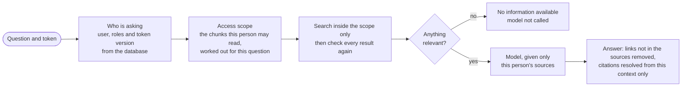

# Permission-Aware Enterprise Knowledge System

A question-answering system over internal company documents where a person can only get answers built from documents they are allowed to read.

Most RAG examples put every document into one vector index, so the only thing between a sales employee and the executive pay policy is a line in the prompt asking the model not to tell. That isn't a security control: the model can be talked round, and it can't unsee what's in its context. Here, permissions are decided by ordinary code, from the database, before anything reaches the model. The model never sees what the person may not read, so there is nothing for it to leak.

The setting is AcmeCorp, a fictional company I wrote for this project: seven departments, nine people, seventeen documents in PDF, Word and text. None of it is real.

**Live demo:** [https://permission-aware-enterprise-knowledge-system-ij67laxbihrkmrqfw.streamlit.app/](https://permission-aware-enterprise-knowledge-system-ij67laxbihrkmrqfw.streamlit.app/). It sleeps when nobody has used it for a while and takes about a minute to wake. Pick a person and ask a question, or ask the same question as two people side by side ([how it works](docs/demo.md)).

## Try this

Ask **"How are executive bonuses calculated?"** as two people:

- **David**, in Sales, gets "No information available to answer this question." That's the same reply as for a question no document covers, so it doesn't reveal that the document exists. The model isn't called at all, because nothing David may read is relevant.
- **Grace**, an executive, gets the formula, citing the document it came from.

Same question, same code, same model. The difference is decided before the model runs. The question is recorded in the audit trail either way.

## Status

Built, tested, measured and packaged to run on a server. Every part below is in the code and covered by tests:

- **Sign-in.** Argon2 passwords. Tokens carry only who you are. Signing out withdraws every token you hold.
- **Authorization.** Four roles and three document classifications. Restricted documents need a named grant.
- **Ingestion.** PDF, Word and text files, treated as untrusted. Documents have versions and can be deleted.
- **Permission-aware retrieval.** Each person's access scope is worked out fresh from the database for every question, and the search runs only inside it. Results are checked again on the way out, and a measured relevance threshold applies.
- **Answers with citations.** Tested with Ollama and Groq. Links the sources don't contain are removed from answers.
- **HTTP API.** 17 routes. Each one is declared with who may call it, or the build fails.
- **Web UI.** It only talks to the API.
- **Audit trail.** Append-only and sealed with an HMAC. Every question, search, refusal and change is recorded.
- **Evaluation.** 73 labelled questions, a leakage test through the real API, answers checked by hand, latency, and one command that checks every target.
- **Deployment.** Docker images, Compose with secrets as files, health checks, JSON logs, monitoring, CI on Linux, and a deployment guide with HTTPS, backups and upgrades.

## How it works



- **The model is untrusted, and so is the UI.** Access is decided in code before the model is called. The UI holds no service code: hiding a page is a convenience, and the API is the check.
- **Filter before the search, not after.** If you search everything and then drop forbidden results, the hidden documents still take places in the top results. A person then gets fewer or worse answers exactly when something hidden matches, and that is a signal ([decision record 0003](docs/adr/0003-pre-filter-vector-search.md)).
- **Permissions live in the database, not in the index.** Changing a label or a grant applies to the next question, with no re-embedding.
- **Hidden and missing look the same.** A document you may not read is a 404, exactly like one that doesn't exist. Every way of getting no answer gives the same response, byte for byte. Document IDs are random, so they don't reveal how many documents exist.
- **No audit record, no answer.** A record of what is about to be sent is stored before the model is called. If it can't be stored, the model isn't called.

The full picture covers the deployment, the packages inside the service, one question step by step, ingestion and the trust boundaries. It's in [Architecture](docs/architecture.md), and a test checks those diagrams against the code.

## Results

Measured on the AcmeCorp data ([evaluation report](docs/evaluation-report.md), [how each number is measured](docs/evaluation.md)):

| What | Result |
|---|---|
| Leaks in 18 forbidden and injection probes, through the API | **0**, in every configuration: no model, Groq, and a model that repeats everything it was given with the relevance threshold switched off |
| Leaks across 4,437 retrievals (9 people × 17 questions × 29 filters) | **0** |
| Wrongful refusals of answerable questions, with Groq | **1 of 34** |
| Answer chunk in the top five | **33 of 34** |
| Answers checked by hand | **33 of 33 correct, 32 faithful** to their sources |
| Prompt injection planted in documents, Groq | Obeyed 5 of 12, harm **0**. It followed the planted exfiltration link both times; the code removed both |
| Latency at p95 | Retrieval **7.4 ms**, an answered question **1.6 s** |
| Cost of the permission filter, median | **2.6 ms** |

A low leak count is easy if the system refuses everything. That's why the wrongful-refusal rate is reported next to it, and each forbidden question has a control person who is allowed to read the document. A detail the report doesn't hide: the LLM judge passed an answer I had marked unfaithful by hand. That's why faithfulness comes from hand-written labels, with the judge checked against them.

## How I tried to break it

Once the checks worked, I asked whether there was a way round them ([security](docs/security.md), [threat model](docs/threat-model.md)):

- **Non-interference.** I build the company twice, differing only in documents one person may not read, and make every request as that person in both. Every response must be byte-identical. That covers counts, order, scores, errors and IDs without listing each leak channel. A control person who *can* read the change must see a difference, so the test can't pass blindly.
- **Every route, every person.** Each route is called by every person and with five kinds of bad token. Each response is searched for text the caller may not read.
- **What it found, and what was fixed:**
  - An admin who was also an employee could relabel a restricted file as "general" and then read it. The rule is now "nobody can give themselves access", tested over every label change on every document.
  - A hidden document's 404 took longer the bigger the document was: 12.5 ms against 9.2 ms for a missing ID. Refused lookups now read the ID alone.
  - The PDF library's warnings were writing document text into the log. Fuzzing found it.
  - Questions were reaching Groq with no audit record when the audit store failed. A record is now stored before the model is called.
- **Deliberate breaks.** After each step I broke the code on purpose and checked that a test failed for the right reason. Where none did, I strengthened the test.

## What it doesn't do

- An admin can still widen access for someone else. The audit trail shows it, but nothing stops it.
- Inference isn't prevented: someone can combine facts they're allowed to see into one they aren't.
- Rate limits and the sign-in throttle live in memory, per process. Signing out ends every device at once.
- The audit trail is tamper-evident, not tamper-proof. Deleting the newest records shows only in the application log.
- It runs on SQLite and has been measured at about 100,000 chunks with random vectors, not run at scale. At that size, an executive's scope takes 296 ms to work out. PostgreSQL, and filtering inside the vector store, are the next steps ([scale](docs/architecture.md#scale)).
- Answer quality was measured on my own questions over documents I wrote, with one model per run.

## Quick start

With Docker:

```
python -m scripts.make_secrets
docker compose up --build
```

The first start seeds the fictional company and builds the index. The UI is then at http://127.0.0.1:8501. Sign in as any AcmeCorp person, for example `david@acmecorp.example`, with the password in `secrets/seed_password`. No model is set by default, so search works and answers need one ([choosing a model](#choosing-a-model)).

Without Docker, see [Setup](#setup) below, then:

```
python -m scripts.seed
python -m scripts.index build
python -m scripts.run
```

## Documentation

- [Requirements](docs/requirements.md): the problem, and the functional, non-functional and security requirements
- [Personas](docs/personas.md): who uses the system and what each person can and cannot see
- [Architecture](docs/architecture.md): the deployment, the packages, one question step by step, ingestion, trust boundaries, and where each check lives
- [Authorization](docs/authorization.md): roles, permissions and the rules that combine them
- [Chunking](docs/chunking.md): how documents are split, with the measurements behind it
- [Retrieval](docs/retrieval.md): from question to chunks, and how the relevance threshold was measured
- [Generation](docs/generation.md): from chunks to an answer with sources
- [API](docs/api.md): every route, who it is for and the errors it gives, with the OpenAPI description in [openapi.json](docs/openapi.json)
- [Audit trail](docs/audit.md): what is recorded, who can read it, and why a request fails without it
- [UI](docs/ui.md): the web UI, which only talks to the API
- [Demo page](docs/demo.md): pick a person, ask, compare two people; how to run and deploy it
- [Evaluation](docs/evaluation.md): the labelled question set and how the system is measured
- [Evaluation report](docs/evaluation-report.md): every target, what was measured, and whether it's met
- [Security](docs/security.md): the promise, where it is kept, what shows it, and how to run it safely; start here for a review
- [Threat model](docs/threat-model.md): 41 threats, what handles each, the tests that show it, and what is left uncovered
- [Configuration](docs/configuration.md): every setting, where settings come from, what production changes, and secrets as files
- [Docker](docs/docker.md): the API and UI images, what is in them, and how to run them
- [Deployment](docs/deployment.md): running it on a server behind HTTPS, backing it up, upgrading it, and what a real company would add first
- [Logging](docs/logging.md): the log's format, following one request, where the time goes, what is never written, and every event
- [CI](docs/ci.md): what runs on every push, what it may do, and what it does and doesn't hold back
- [Monitoring](docs/monitoring.md): the signals, the targets, the rules that call for someone, and what to do when each fires
- [Secrets](docs/secrets.md): what is secret, where it lives, how it is checked and how to replace it
- [Decision records](docs/adr/README.md): the 15 main design choices, the alternatives, and when I'd revisit them

## Setup

Requires Python 3.11.

Windows (PowerShell):

```
python -m venv .venv
.venv\Scripts\Activate.ps1
pip install -r requirements-dev.txt
copy .env.example .env
```

macOS / Linux:

```
python3.11 -m venv .venv
source .venv/bin/activate
pip install -r requirements-dev.txt
cp .env.example .env
```

Then set `APP_JWT_SECRET_KEY` in `.env`. It has no default and must be at least 32 characters:

```
python -c "import secrets; print(secrets.token_urlsafe(48))"
```

## Company data

`data/acmecorp` holds the company: 7 departments, 9 users and 17 documents. The documents are kept the way a company would have them: published policies and procedures as PDF, working papers as Word files, and engineering notes and a case system export as plain text. `manifest.json` lists them with each document's department, classification and named readers.

```
python -m scripts.seed
```

This creates the tables and loads everything, 57 chunks included. Documents go through the normal ingestion pipeline, uploaded by the knowledge admin, so labels and grants are checked by the same code as any other upload. Running it again adds nothing and does not reset passwords.

All seeded users share one password. Pass it with `--password`, or set `SEED_PASSWORD`; otherwise one is generated and printed once. The script refuses to run when `APP_ENVIRONMENT` is `production`.

| User | Department | Role |
|---|---|---|
| alice@acmecorp.example | Engineering | employee |
| bob@acmecorp.example | Finance | employee |
| carol@acmecorp.example | HR | employee |
| david@acmecorp.example | Sales | employee |
| emma@acmecorp.example | Legal | employee |
| frank@acmecorp.example | Operations | employee |
| grace@acmecorp.example | Executive | executive |
| henry@acmecorp.example | Engineering | knowledge admin |
| irene@acmecorp.example | Legal | security reviewer |

Three documents are company-wide, twelve belong to a department, and two are restricted: an HR case file that only Carol can read, and an acquisition paper readable by Grace and, for 60 days, by Emma. Henry manages documents without being able to read them, and Irene reads the audit trail but not documents.

## Vector index

```
python -m scripts.index build              # build a new version and make it current
python -m scripts.index status             # list versions; exit code 2 if out of date
python -m scripts.index rollback [VERSION] # go back to an earlier version
```

`build` embeds the chunks of every active document and writes a new version under `data/index/versions/`. The new version is loaded back and checked before the `current` pointer is moved to it, so a failed build leaves the previous one in use. The last three versions are kept (`APP_INDEX_KEEP_VERSIONS`). The first run downloads the embedding model.

Each version has a manifest with the embedding model, the chunk settings, a checksum of the index file and a fingerprint of the text that was embedded. Loading refuses a version built with a different model or chunk settings, or whose files don't match. `status` reports the index as out of date when documents have been added, replaced or deleted since it was built. A label or grant change doesn't make it out of date, because permissions are not in the index.

The index holds vectors of every document, restricted ones included. It is not committed, and it needs the same protection as the database.

## Audit trail

```
python -m scripts.audit check   # every record against its seal; exit code 2 if anything doesn't match
```

Every record is sealed with a keyed hash when it is written, so a record changed, added, deleted or moved by someone with the database but not the service's key is found. The check prints the highest record ID; the application log has each one too, which is what shows the newest records deleted. See [docs/audit.md](docs/audit.md) and [decision record 0013](docs/adr/0013-seal-each-audit-record.md).

## Running the API

```
uvicorn app.main:serve --factory --no-access-log
```

It needs the company data and an index (above), and refuses to start without a usable index. `GET /health` answers `{"status": "ok"}`; the interactive documentation is at `/docs`, and the same description is in [docs/openapi.json](docs/openapi.json) for when the service isn't running. Each person may ask 10 questions a minute and 200 a day, and search 30 times a minute ([how it counts](docs/api.md#how-often)). See [docs/api.md](docs/api.md).

## Running the API and the UI

```
python -m scripts.run
```

It starts the API, waits until it answers its health check, then starts the UI pointed at it, and prints where to go: http://127.0.0.1:8501 by default. Ctrl+C stops both, and if either stops the other is stopped too. `--api-port`, `--ui-port` and `--host` change where they listen; both listen on this machine only unless told otherwise.

Sign in as any of the AcmeCorp people with the password given to `python -m scripts.seed`. Each person sees the pages their role allows. To run them separately, start the API as above and, in a second terminal, `streamlit run ui/app.py`; the UI finds the API at `UI_API_URL`, `http://127.0.0.1:8000` by default. See [docs/ui.md](docs/ui.md).

## Docker

```
docker build --target api -t knowledge-api .
docker build --target ui  -t knowledge-ui  .
```

Two images: the API, with the embedding model built in so a container fetches nothing, and the UI, which holds none of the service because it only talks to the API. Both run as an unprivileged user and hold no secret; the database and index live on a volume.

`python -m scripts.make_secrets` makes the signing key, the fictional company's password and an empty model key as files in `secrets/`, which the containers read instead of their environment. `docker compose up --build` then seeds, indexes and starts both, the UI once the API answers its health check. `docker compose logs --no-log-prefix --since 15m api | python -m scripts.monitor` reports how it is doing and whether anyone is needed ([monitoring](docs/monitoring.md)). On a server, `compose.tls.yaml` puts HTTPS in front; [deployment](docs/deployment.md) has every step, backups included. How the containers are hardened is in [docs/docker.md](docs/docker.md); every setting is in [docs/configuration.md](docs/configuration.md).

## Choosing a model

Answers come from a language model chosen with `APP_LLM_PROVIDER` (see `.env.example`). The default, `none`, sends nothing anywhere: search works, and asking is refused with 503.

- **Ollama**, free and on your own machine: install [Ollama](https://ollama.com), run `ollama pull llama3.1`, and set `APP_LLM_PROVIDER=ollama` and `APP_LLM_TIMEOUT_SECONDS=300`. An answer takes about a minute on a laptop CPU.
- **Groq**, fast, with a free tier: create a key at [console.groq.com](https://console.groq.com), put it in `.env` as `APP_LLM_API_KEY`, and set `APP_LLM_PROVIDER=groq` and `APP_LLM_MAX_OUTPUT_TOKENS=1000`. The prompt, which is document text, then goes to Groq.

## Checks

```
ruff check .
ruff format --check .
mypy
pytest --cov
```

That runs more than 3,700 tests, at about 99% coverage. GitHub runs the same on Linux for every push, and builds and runs the images when anything in them changes ([CI](docs/ci.md)).

To look for secrets in every tracked file and every commit, the local `.env`'s own values included (it prints where, never what):

```
python -m scripts.scan_secrets
```

Some tests generate their inputs with [Hypothesis](https://hypothesis.readthedocs.io): files damaged at random, questions, answers, titles, filters and requests to every route. The examples are the same on every run, so a failure can be run again.

The security tests are part of every run, and can be run alone with `pytest tests/security`. These are left out of a normal run, and run on their own:

```
pytest -m docker          # the tests that build and run the images; need Docker
pytest -m model           # the real embedding model and reranker; the first run downloads about 90 MB each
pytest -m llm             # the real local model through Ollama; about a minute an answer
```

## Stack

Python 3.11, FastAPI, SQLAlchemy over SQLite, Argon2 password hashing, PyJWT, pypdf and python-docx, sentence-transformers with the `all-MiniLM-L6-v2` embedding model (and the `ms-marco-MiniLM-L6-v2` cross-encoder for optional reranking, off by default), FAISS, pydantic-settings, Streamlit and httpx for the UI. Ollama or Groq for answers. Docker and Compose, Caddy for HTTPS, GitHub Actions for CI. pytest, Hypothesis, ruff and mypy.

PostgreSQL is the target database and isn't used yet. Libraries are added to the requirements files only when the part that needs them is built.
