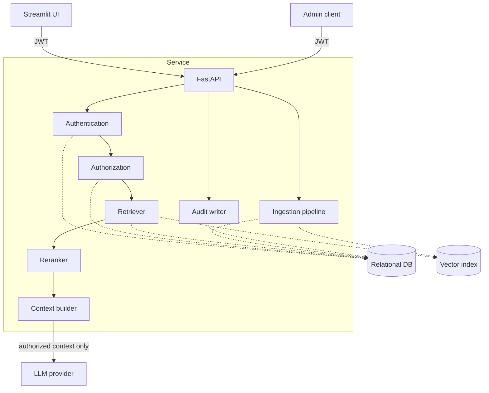

# Architecture

Status: Draft
Date: October 2026

This describes how the system is put together and why. It covers the components, the two main flows (asking a question, ingesting a document), where data lives and where the security boundary sits. Requirements it refers to (FR, NFR, SR) are in [requirements.md](requirements.md).

## The one rule

Everything that decides what a user may see is ordinary code that runs before the LLM is called. The LLM gets a context that has already been filtered, and nothing it does can add to that context.

## Components



| Component | What it does | What it must not do |
|---|---|---|
| UI (Streamlit) | Login, ask, show answers and sources | Talk to the database or index. It only calls the API. |
| API (FastAPI) | Routing, input validation, error mapping | Contain permission logic of its own |
| Authentication | Verifies the token and loads the user | Trust department or roles sent by the client |
| Authorization | Turns a user into an access scope, and answers "can this user read this document?" | Be bypassed. It is the only place that decides access (SR-3). |
| Retriever | Finds the most similar chunks inside the user's scope | Return a chunk outside the scope |
| Reranker | Reorders the authorized candidates | See anything the retriever didn't return |
| Context builder | Picks chunks up to the size cap and formats them with source labels | Add content from anywhere else |
| LLM provider | Writes the answer from the context | Make any access decision |
| Ingestion pipeline | Validates, extracts, chunks, embeds and stores a document | Accept a document with no department or classification |
| Audit writer | Records every query and admin action | Be skippable |

## Asking a question

1. The client sends the question with a JWT.
2. Authentication checks the signature and expiry, then loads the user from the database by the ID in the token.
3. Authorization builds the user's access scope from their department and roles.
4. The retriever asks the database which chunks fall inside that scope, embeds the question, and searches the vector index restricted to those chunk IDs.
5. Each returned chunk is checked once more against the authorization service before it leaves the retriever.
6. The reranker reorders the candidates.
7. The context builder takes the top chunks up to the cap (NFR-3).
8. If there are no chunks, or none score above the relevance threshold, the service returns the standard "no information available" response. The LLM is not called.
9. Otherwise the LLM is called with the question and the context, and returns an answer with references to the chunks it used.
10. Citations are resolved from chunk IDs. Only chunks that were in the context can be cited.
11. An audit record is written, and the response is returned.

Search (FR-8) is the same flow stopped after step 6. The document list (FR-5) uses the same access scope from step 3 against the documents table.

## Decisions

A summary of each. The alternatives I considered and when I'd revisit them are in the [decision records](adr/README.md).

### Permissions live in the database, not in the index

The vector index holds vectors and chunk IDs and nothing else. Department, classification and grants are rows in the database. A permission change is a row update and takes effect on the next query, with no re-embedding (SR-8).

The alternative was to copy permission metadata next to each vector. That is how most vector databases filter, but with FAISS it would mean a second copy of the permissions that could drift from the first.

### Filter before the search, then check again after

The retriever first gets the allowed chunk IDs for the user, then runs the similarity search only over those IDs. FAISS supports restricting a search to a set of IDs.

The simpler option is to search everything and drop unauthorized results afterwards. I didn't choose it for two reasons. Unauthorized chunks would take up places in the top K, so a user with narrow access gets fewer or worse results. And it puts unauthorized content one bug away from the context.

Step 5 above is a second check on the way out. It should never remove anything. If it does, that is logged as an error, because it means the first filter is wrong.

### The token carries identity only

The JWT holds the user ID and expiry. Department, roles and whether the account is active are read from the database on every request. So a deactivated user or a changed role takes effect on the next request, not when the token expires (SR-8).

The cost is one database lookup per request. For this system that is small next to an embedding and an LLM call.

### "No access" and "not found" are the same code path

Both cases end at step 8 with zero usable chunks, so they produce the same response by construction (SR-10). There is no separate "forbidden" branch that could behave differently.

### If the audit record can't be written, the request fails

A query that can't be audited is not answered. This costs availability when the database has problems, but an unaudited answer is worse for this system than an error.

### Embeddings are computed locally

Document text is embedded with a local sentence-transformers model. Text only leaves the service at the LLM call, and only the authorized context for that one question (SR-13).

### One service, separate modules

Authentication, authorization, retrieval, generation and ingestion are modules inside one FastAPI service, not separate services. The corpus and the team are small, and a network hop between authorization and retrieval would add failure modes without adding safety. The modules talk through interfaces, so they could be split later.

## Ingesting a document

1. An admin uploads a file with its owning department and classification.
2. The API validates file type and size, and rejects the upload if department or classification is missing (FR-2).
3. Text is extracted (PDF, DOCX or TXT) and cleaned.
4. The text is split into chunks. Each chunk row points to its document.
5. Chunks are embedded.
6. Document and chunk rows are written to the database, and vectors are added to the index under their chunk IDs.
7. The action is audited.

A chunk has no permissions of its own. It reads them from its document, so it can't be more open than the document (SR-5).

Replacing a document creates a new version and marks the old chunks inactive. Deleting marks the document removed. In both cases the scope query stops returning those chunks immediately, and their vectors are dropped at the next index rebuild.

## Data stores

| Store | Holds | Local | Target |
|---|---|---|---|
| Relational database | Users, departments, roles, documents, chunks (text and metadata), permissions, audit log | SQLite | PostgreSQL |
| Vector index | Vectors and chunk IDs | FAISS file on disk | FAISS, or a vector database (see Scale) |
| Index manifest | Embedding model, chunk settings, index version, build time | JSON file next to the index | same |

On startup the service compares the manifest with its configured embedding model and refuses to serve queries if they differ (NFR-6).

The audit log is a table that the service only ever inserts into.

## Trust boundaries

- Client to API: nothing from the client is trusted except a valid token. The user's department is never taken from the request.
- Service to LLM provider: the only point where document text leaves the service. Only authorized context crosses it.
- Document content: treated as data. Text inside a document is never interpreted as an instruction by the service, and whatever the model does with it, the context is already fixed (SR-11).
- Storage: the database and index files are readable only by the service (SR-14).

## When things fail

| Failure | Behaviour |
|---|---|
| Token invalid, expired, or user inactive | 401, nothing else runs |
| Authorization or scope query errors | Request fails, no content returned (NFR-4) |
| Second check removes a chunk | Chunk dropped, error logged, request continues with the rest |
| Index manifest doesn't match config | Service refuses to serve queries |
| LLM provider down or times out | Q&A returns an error after limited retries; search still works (NFR-5) |
| Audit write fails | Request fails |

## Scale

Not tested beyond the sample corpus. What I expect to change:

- Allowed-ID lists get large. Passing tens of thousands of IDs per query stops being reasonable. At that point the filter should run inside the vector store: pgvector (permission join and vector search in one SQL query) or a vector database with metadata filtering.
- Exact search becomes slow. A flat FAISS index compares against every vector. Larger corpora need an approximate index, and approximate search combined with filtering needs care so that filtered queries still return enough results.
- Scope lookups repeat. The access scope per user could be cached for a short time, at the cost of a delay on revocation equal to the cache lifetime.
- Ingestion blocks the API. It would move to a background worker with a queue.

## Repository layout

```
app/
  api/            HTTP routes and request/response schemas
  core/           config, logging, exceptions, database session
  auth/           login, tokens, current user
  authorization/  access scope and permission checks
  ingestion/      file validation, text extraction, chunking, embedding
  retrieval/      scope query, vector search, reranking
  rag/            context builder, prompt, LLM providers
  audit/          audit writer and reader
  models/         database models
ui/               Streamlit app, calls the API only
tests/
  unit/
  integration/
  security/       permission boundary and leakage tests
data/
  sample/         synthetic AcmeCorp documents (committed)
  uploads/        ingested files (not committed)
  index/          vector index and manifest (not committed)
scripts/          seeding, index build, evaluation runs
docs/
```

The packages under `app/` match the components in the diagram above, one to one. Three choices worth explaining:

- `authorization/` is separate from `auth/`. Who you are and what you may read are different questions, and keeping them apart makes it obvious where access is decided.
- There is no general `services/` package. Logic lives in the module that owns it, so nothing ends up in a catch-all.
- Security tests have their own folder so they can be run alone and made a required check in CI.

`ui/` sits outside `app/` because it is a separate process and must not import from the service.

## Not decided here

The exact role and classification model, the database schema, the chunking strategy, the embedding and reranking models, and the prompt. Each is decided in its own part of the build.
