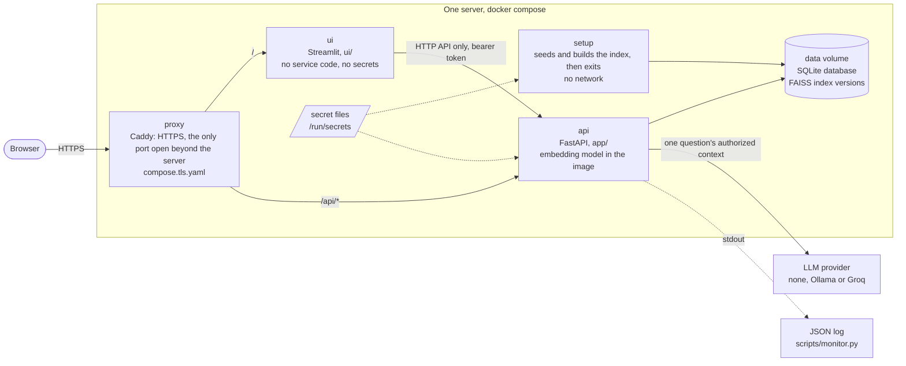
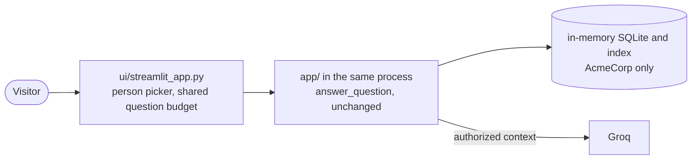
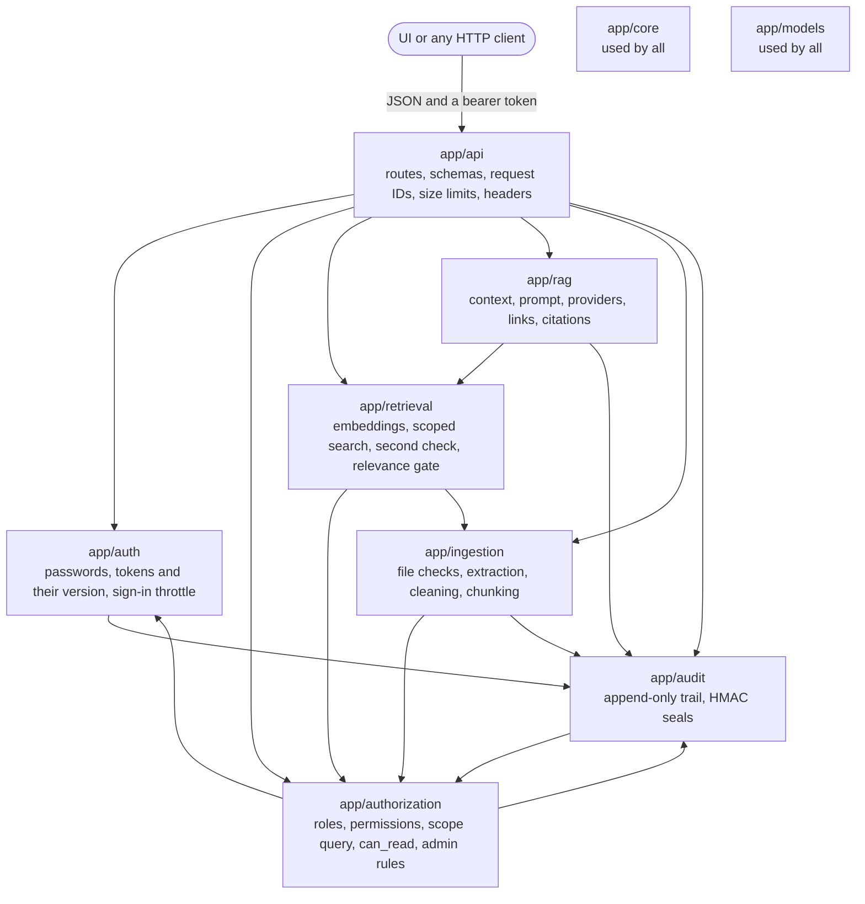
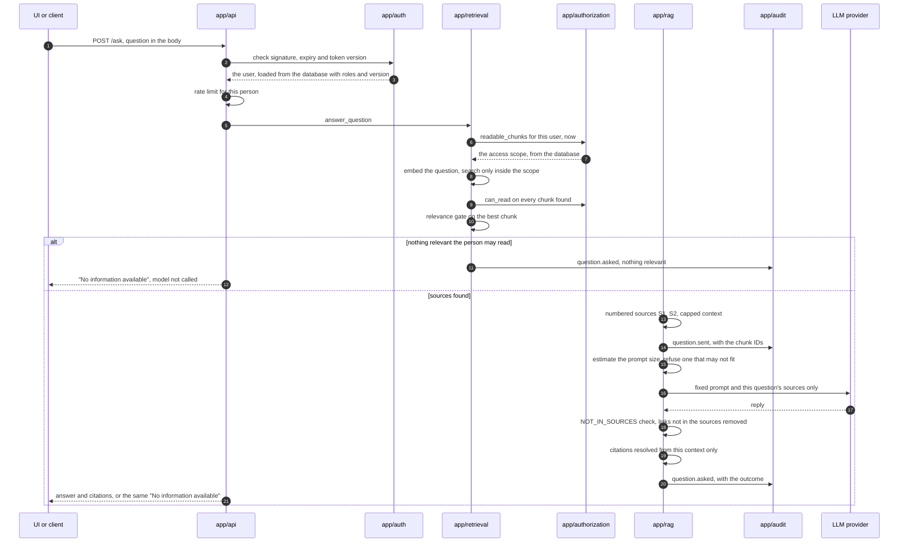
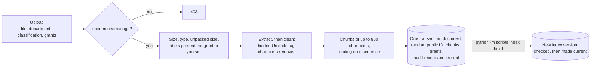
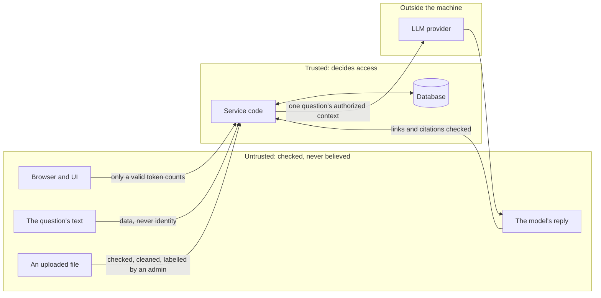

# Architecture

Status: Built
Date: October 2026

This is how the system is put together now that it's built, and why. It started as a plan written before any code; every diagram here describes the code as it is, and [a test](../tests/unit/test_architecture_doc.py) keeps them from drifting: the components diagram must name every package under `app/`, its arrows must be exactly the imports between them, and the deployment diagram must show every service Compose starts. Requirements it refers to (FR, NFR, SR) are in [requirements.md](requirements.md), threats (T1 to T41) in [the threat model](threat-model.md).

## The one rule

Everything that decides what a person may see is ordinary code that runs before the model is called. The model gets a context that has already been filtered, and nothing it does can add to that context. The model is treated as untrusted, and so is the UI.

## The system as it runs

What `docker compose up` starts on one server ([docker.md](docker.md), [deployment.md](deployment.md)):



| Service | Runs | Holds | Reaches |
|---|---|---|---|
| `setup` | Once per start: seeds, then builds the index if it is missing or out of date | The signing key and the seed password | Nothing: `network_mode: none` |
| `api` | The service, after `setup` succeeds | The signing key, the model key, the data volume | The model provider, if one is set |
| `ui` | The pages, after the API's health check passes | Nothing of the service: no code, no setting, no secret | The API, at `http://api:8000` |
| `proxy` | HTTPS in front of both, with `compose.tls.yaml` | Its certificates | The UI and the API |

Every container runs read-only with every Linux capability dropped, and the proxy keeps only the one to listen on 80 and 443. The API and UI images run as a user other than root. Without the proxy, the UI and the API listen on 127.0.0.1 only. Secrets are files, not environment variables, because anyone who can inspect a container reads its environment ([secrets.md](secrets.md)). The service writes one JSON line per event to stdout; `scripts/monitor.py` reads that log and says who is needed ([monitoring.md](monitoring.md)), and `python -m scripts.audit check` checks every audit record against its seal ([audit.md](audit.md)).

### The public demo is a different shape

The demo on Streamlit Community Cloud runs `ui/streamlit_app.py`, which imports the service and runs it in the same process: the fictional company is seeded into an in-memory database and indexed when the page starts. Picking a person stands in for signing in, which is why it only ever holds AcmeCorp. Everything after that is the real code: the same `answer_question`, the same access checks, the same prompt ([demo.md](demo.md)). Those two files are the only ones under `ui/` allowed to import the service; a test fails if any other does.



## Inside the service

One FastAPI process, one package per concern. An arrow is an import: `a --> b` means code in `a` calls code in `b`. Every package also uses `app/core` (settings, database session, logging, rate limits, errors) and `app/models` (the tables), so those two have no arrows.



Some of these arrows are worth explaining:

- **`retrieval --> authorization`** is where the rule is used: the scope is the `readable_chunks` query, and the second check is `can_read`. Retrieval decides nothing about access itself.
- **`rag --> retrieval`, and nothing from `rag` to the index.** The only way from a question to the model is `answer_question`, which retrieves first. There's no function in `app/rag` that searches.
- **`retrieval --> ingestion`** is the cleaning step only: a question is cleaned the same way a document is.
- **`audit --> authorization`**: reading the trail needs its own permission (`audit:read`), checked where the trail is read.
- **`authorization --> auth`**: the route dependencies that check a permission start from the signed-in user.

The 17 routes are listed with their audiences in [api.md](api.md). Each one must be declared in a table of who it is for, or the build fails (T4).

## Asking a question

`POST /ask`, from the token to the answer. Each step that can stop the request is in the order the code runs it.



1. **Identity.** The token holds the user's ID, its expiry and the user's token version when it was issued (decision records [0004](adr/0004-identity-only-token.md) and [0015](adr/0015-withdraw-tokens-with-a-version.md)). Department, roles, whether the account is active and its current version are loaded from the database in one query on every request. A deactivated account, a changed role or a sign-out applies to the next request.
2. **Scope.** The person's access scope is worked out fresh for each question and never cached. The search refuses a scope older than 60 seconds, or dated in the future.
3. **Scoped search.** FAISS is only ever searched with the scope's chunk IDs; there is no function that searches everything. A hit outside the scope fails the request.
4. **Second check.** Every chunk found is checked again with `can_read`, the same rule written in Python instead of SQL. It should never remove anything. If it does, the chunk is dropped and an error logged (decision record [0003](adr/0003-pre-filter-vector-search.md)).
5. **Relevance gate.** Below a measured threshold on the best chunk, the answer is "No information available" and the model is not called ([retrieval.md](retrieval.md)).
6. **Before the model.** A `question.sent` audit record is stored first. With a hosted model this is company text leaving the machine; if the record can't be stored, the model isn't called. The prompt's size is estimated at 3 characters per token, and a prompt that may not fit the model's window is refused, because Ollama cuts an oversized prompt from the start without an error ([generation.md](generation.md)).
7. **After the model.** A reply that says `NOT_IN_SOURCES` anywhere becomes the standard "No information available". Links the sources don't contain are removed (T34). Citations are looked up in this question's context only, and a label that isn't there is removed (T28).
8. **Every way of getting nothing is the same response**, byte for byte: nothing in scope, below the gate, or the model saying NOT_IN_SOURCES.

Search (`POST /search`) is the same flow, stopped after step 5. The document list and `GET /documents/{id}` use `readable_documents` and `can_read` from the same module, and a document the person may not read is a 404, exactly like one that doesn't exist (decision record [0005](adr/0005-same-response-for-no-access-and-not-found.md)).

## Ingesting a document



1. The request body's size is limited in the middleware, before anything reads it. The pipeline then checks the admin's permission before it looks at the file.
2. The file is checked: type, size, and for Word files how large it unpacks. An upload without a department or a classification is refused (FR-2).
3. A grant can't name the admin making it. Later, a label change that would let the admin making it read the document is refused too (T18).
4. The text is extracted and cleaned, and split into chunks. A chunk has no permissions of its own: it points to its document, so it can't be more open than the document (SR-5).
5. The document, its public ID, its chunks, its grants and the audit record are stored in one transaction, or nothing is.
6. Search finds it once the index is rebuilt and the service restarted. Until then it is readable through the list and by ID, and the admin's view says `in_index: false`. The build writes a new version, loads it back and checks it before moving the `current` pointer, so a failed build leaves the old one in use.

Replacing a document stores a new version and marks the old one superseded; deleting marks it deleted. Either way the scope query stops returning its chunks at once. Their vectors stay until the next build, and are never found, because no scope contains them.

## Where each check is in the code

| Check | Code | Threats |
|---|---|---|
| Identity from the token only, everything else from the database, on every request | `app/auth/service.py`, `app/auth/tokens.py` | T3, T7, T8, T9 |
| A token withdrawn when its owner signs out | `app/auth/service.py` | T41 |
| Guessing passwords is slowed, per email as typed | `app/auth/throttle.py` | T10 |
| Every route asks for the permission its audience needs | `app/authorization/dependencies.py` | T4, T38 |
| The access scope, as one SQL query | `app/authorization/service.py`, `app/retrieval/scope.py` | T1, T2, T5 |
| The search only inside the scope, and only with a fresh scope | `app/retrieval/search.py` | T1 |
| A second check of every chunk found | `app/retrieval/retriever.py` | T5 |
| Filters only narrow the scope | `app/retrieval/filters.py` | T26, T27 |
| A hidden document is a missing one, refused without loading it | `app/authorization/checks.py` | T11, T35 |
| Documents named outside by a random ID | `app/models/document.py` | T36 |
| No information, the same way every time | `app/retrieval/retriever.py`, `app/rag/answer.py` | T13 |
| Only a prompt built from the context reaches the model, with nothing about the person in it | `app/rag/prompt.py`, `app/rag/llm.py` | T23 |
| A prompt that may not fit is refused | `app/rag/providers.py` | T24 |
| Links the sources don't contain are removed | `app/rag/links.py` | T34 |
| Citations from this question's context only | `app/rag/citations.py` | T28 |
| Upload checks | `app/ingestion/extractors.py`, `app/ingestion/pipeline.py` | T16, T17 |
| An admin can't give themselves access | `app/authorization/document_access.py` | T18 |
| Every request, refusal and change audited in the same transaction, or not done | `app/audit/trail.py`, `app/rag/answer.py` | T15, T39 |
| The trail can't be changed, and is sealed so a change is found | `app/audit/trail.py`, `app/audit/seals.py`, `app/models/audit.py` | T22 |
| Rate limits on asking and searching | `app/core/rate_limit.py` | T24 |
| Request size limit, no caching, request IDs | `app/api/middleware.py` | T6, T40 |
| No document text or question in the log | `app/core/logging_setup.py` | T21 |
| The UI draws service text as text, never as Markdown | `ui/text.py` | T29 |
| The UI reaches the service only through the HTTP API | `ui/client.py` | T4 |

Which tests prove each threat is handled is in [the threat model](threat-model.md#where-each-check-lives).

## Trust boundaries



- **Client to API.** Nothing from the client counts except a valid token. A department, a role or "I am the CEO" in the request changes nothing (T3, T8).
- **Document content is data.** A document may hold instructions for the model. Access control can't stop that, because the reader may read that document, so the reply is checked instead: links out removed, citations resolved locally (T14, T34).
- **Service to model provider.** The one place document text leaves the service, and only one question's authorized context crosses it, recorded before it goes (SR-13).
- **Storage.** The database and the index hold everything, restricted documents included, and need the same protection as each other (T19).

## Decisions

Each in short; the alternatives and when I'd revisit them are in the [decision records](adr/README.md).

- **Permissions live in the database, not in the index** ([0002](adr/0002-permissions-in-the-database.md)). The index holds vectors and chunk IDs. A permission change is a row update that applies on the next question, with no re-embedding (SR-8).
- **Filter before the search, then check again** ([0003](adr/0003-pre-filter-vector-search.md)). Searching everything and dropping results afterwards leaks even when it shows nothing forbidden: hidden chunks take places in the top results, so a person gets fewer or worse results exactly when something hidden matches.
- **The token carries identity and a version** ([0004](adr/0004-identity-only-token.md), [0015](adr/0015-withdraw-tokens-with-a-version.md)). Roles are read on every request. Signing out moves the version on, which withdraws every token the person holds. The version is loaded with the user, so it costs no query of its own.
- **"No access" and "not found" are one response** ([0005](adr/0005-same-response-for-no-access-and-not-found.md)), and the trail still records which it was.
- **No audit record, no answer** ([0006](adr/0006-fail-request-when-audit-fails.md)). An unaudited answer is worse here than an error.
- **Each audit record sealed on its own** ([0013](adr/0013-seal-each-audit-record.md)), not a hash chain, so concurrent writers share no state.
- **Document IDs are random outside the service** ([0014](adr/0014-random-public-document-ids.md)), so they don't count what's stored.
- **Restricted means named** ([0010](adr/0010-restricted-documents-need-a-grant.md)): a restricted document needs a grant, even for an executive.
- **Embeddings are computed locally, the model is a setting** ([0009](adr/0009-local-embeddings-configurable-llm.md)). Text leaves only at the model call.
- **FAISS and SQLite here** ([0007](adr/0007-faiss-and-sqlite-locally.md)), behind interfaces, with PostgreSQL as the target.
- **One service, separate packages** ([0008](adr/0008-single-service.md)). A network hop between authorization and retrieval would add failure modes without adding safety. The packages talk through functions, so they could be split later.

## Data stores

| Store | Holds | Here | In a company |
|---|---|---|---|
| Database | Users, roles, token versions, departments, documents and their public IDs, chunks with their text, grants, the audit trail and its seals | SQLite, on the `data` volume | PostgreSQL |
| Vector index | Vectors and chunk IDs, every version kept, a `current` pointer | FAISS files on the `data` volume | A vector store that filters by itself, such as pgvector |
| Index manifest | Embedding model, chunk settings, checksum, build time | JSON in each index version | The same |
| Application log | One JSON line per event: never a question, an answer or document text | stdout | A log platform |
| Secrets | Token signing key (which also derives the audit seal key), seed password, model key | Files in `/run/secrets` | A secret manager |

The service refuses to start with an index that is missing, damaged, or built with another model or other chunk settings (NFR-6).

## When things fail

| Failure | What happens |
|---|---|
| Token invalid, expired, withdrawn, or the account inactive | 401, nothing else runs |
| Too many failed sign-ins for one email, or too many questions | 429, saying when to try again |
| The scope is too old, dated in the future, or a hit falls outside it | The request fails with 500, an error logged |
| The second check removes a chunk | Chunk dropped, error logged, the answer goes on with the rest |
| No model configured, or the provider down, slow or rate-limiting | Retried with a growing pause when it may recover, then 503. Search still works (NFR-5) |
| The prompt may not fit the model's window | 503, without calling the model |
| An audit record can't be written | 503. Before the model call, the model isn't called |
| The index doesn't match the settings | The service doesn't start |
| The database stops answering | The health check fails with 503, and Docker marks the API unhealthy |

## Scale

Measured with the real permission structure at about 100,000 chunks ([evaluation.md](evaluation.md)): Grace, who may read about 93,000 of them, pays 296 ms to work out her scope and 43 ms to search inside it, against 7 ms to search everything. It grows with the size of the scope (T33). What I'd change, in order:

- Work out the scope by document rather than by chunk, or filter inside the vector store (pgvector does the permission join and the search in one query).
- Move from exact to approximate search, checking that a filtered search still returns enough.
- Move the database to PostgreSQL, the audit trail to write-once storage, and the rate limits to Redis so they hold across processes.
- Move ingestion and index builds to a background worker.

## Repository layout

```
app/
  api/            routes, schemas, middleware, error mapping
  auth/           passwords, tokens, sign-in throttle, current user
  authorization/  permissions, access scope, checks, admin rules
  retrieval/      embeddings, index and its versions, scoped search, retriever, filters, reranking
  rag/            context, prompt, providers, links, citations, answer_question
  ingestion/      file checks, extraction, cleaning, chunking, pipeline
  audit/          trail and seals
  models/         database tables
  core/           settings, database, logging, rate limits, errors
ui/               Streamlit pages, through the HTTP API; demo.py and streamlit_app.py for the demo
scripts/          seed, index, audit check, monitor, secrets, run
evaluation/       the labelled questions, the measurements and the report
tests/
  unit/  integration/  security/  docker/
data/
  acmecorp/       the fictional company's documents (committed)
deploy/           the proxy's Caddyfile
.github/workflows/  CI and the Docker workflow
docs/             these pages and the decision records
```

`authorization/` is separate from `auth/`: who you are and what you may read are different questions, and keeping them apart makes it obvious where access is decided. `ui/` sits outside `app/` because it is a separate process.
